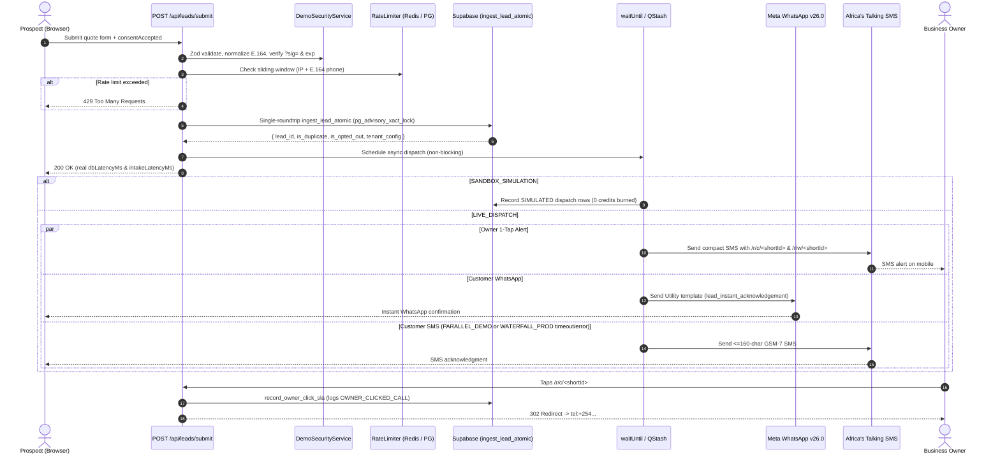

# Chameleon Engine (`chameleon-engine`)

**Sub-Second B2B Lead Recovery, Dual-Channel Messaging Orchestration & White-Label Dynamic Demo Engine**

Chameleon is a production-hardened **Next.js App Router + Supabase PostgreSQL + Meta WhatsApp Cloud API (`v26.0`) + Africa's Talking SMS** lead recovery platform engineered for high-ticket service verticals in Kenya and East Africa (Commercial Solar EPC, Borehole Drilling, Direct Vehicle Imports, Aesthetic Dental Clinics, and Heavy Plant Hire).

It captures high-intent leads through a strictly white-labeled, dynamically themed intake portal, validates and persists inquiries in **under 250ms** via an advisory-locked PostgreSQL transaction, returns `200 OK` immediately with empirical latency telemetry, and dispatches multi-channel follow-ups asynchronously via Vercel `waitUntil()` / Upstash QStash.

---

## Table of Contents

1. [Why Chameleon Exists (Speed-to-Lead Economics)](#1-why-chameleon-exists-speed-to-lead-economics)
2. [Key Capabilities](#2-key-capabilities)
3. [Hexagonal Domain Architecture](#3-hexagonal-domain-architecture)
4. [End-to-End Execution Pipeline](#4-end-to-end-execution-pipeline)
5. [Database Schema, RPCs & State Machine (`schema.sql`)](#5-database-schema-rpcs--state-machine-schemasql)
6. [Security, Anti-Abuse & ODPC Compliance](#6-security-anti-abuse--odpc-compliance)
7. [Telecom Cost Optimization & Dispatch Strategies](#7-telecom-cost-optimization--dispatch-strategies)
8. [Supported Industry Verticals (`niches.ts`)](#8-supported-industry-verticals-nichests)
9. [Complete API & Route Reference](#9-complete-api--route-reference)
10. [White-Label Enterprise Frontend & Theme Injection](#10-white-label-enterprise-frontend--theme-injection)
11. [Environment Variables Reference](#11-environment-variables-reference)
12. [Local Development & Production Deployment Guide](#12-local-development--production-deployment-guide)
13. [Verification & Testing](#13-verification--testing)

---

## 1. Why Chameleon Exists (Speed-to-Lead Economics)

High-ticket B2B buyers routinely submit quote requests to 3–5 competing contractors simultaneously. Industry benchmarks show:
- **~78%** of high-ticket buyers purchase from the **first vendor to respond**.
- Responding within **1 minute** delivers up to **391%** higher conversion rates versus delayed follow-up and roughly **30%** higher conversion than a 5-minute response.
- Standard contact forms land in unmonitored email inboxes for hours while field engineers or directors are on-site.

Chameleon eliminates lead decay by turning every form submission into:
1. An **instant Utility WhatsApp acknowledgment** (`~$0.0040` / `~KES 0.52` in Kenya).
2. A **smart GSM-7 SMS fallback** (`~KES 0.80`) triggered only when WhatsApp fails or does not deliver within a configurable window (`WATERFALL_PROD`).
3. A **trackable 1-Tap Owner Alert SMS** containing compact `/r/c/<id>` (call) and `/r/w/<id>` (WhatsApp) redirect links that measure exact owner response SLA and escalate unclaimed leads after 5 minutes.

---

## 2. Key Capabilities

- **Sub-250ms Atomic Lead Ingestion:** Eliminates check-then-insert race conditions and serverless `Promise.race` Lambda freezes using a single-roundtrip PostgreSQL RPC (`ingest_lead_atomic`) with `pg_advisory_xact_lock` + non-blocking `waitUntil()` / QStash execution.
- **Smart Dual-Channel Cost Control:**
  - `PARALLEL_DEMO`: Fires WhatsApp + Customer SMS + Owner 1-Tap Alert concurrently for live prospect demonstrations.
  - `WATERFALL_PROD`: Sends Customer WhatsApp + Owner Alert immediately and suppresses Customer SMS if Meta confirms delivery within the waterfall window.
- **Zero-Credit-Burn Demo Security:** Unsigned, expired, or tampered demo URLs run strictly in `SANDBOX_SIMULATION` mode. Only cryptographically verified HMAC-SHA256 `?sig=` URLs trigger `LIVE_DISPATCH`.
- **GSM-7 SMS Cost Guard:** Automatically sanitizes Unicode punctuation (en-dashes, smart quotes, emojis) to prevent Africa's Talking from downgrading messages from 160-character GSM-7 to 70-character UCS-2 segments, and compresses 36-char UUIDs into 22-char Base64url tokens.
- **Idempotent Webhook Ledger & Monotonic State Machine:** Deduplicates Meta & Africa's Talking retries in `webhook_events` and prevents delayed callbacks (e.g., `SENT` arriving after `DELIVERED` or `CUSTOMER_REPLIED`) from regressing lead statuses.
- **Kenya ODPC Data Protection Act (2019) Compliance:** Enforces unbundled affirmative opt-in consent, logs `consent_accepted_at` and `privacy_notice_version`, renders a white-label `/privacy` notice covering cross-border cloud processing, and suppresses outbound sends on inbound `STOP` replies.
- **3-Color Light-First White-Label UI:** Inspired by Linear, Vercel, and Stripe Dashboard (`#F8FAFC`/`#FFFFFF`, `#0F172A`/`#334155`, and validated `--brand-color`) with zero platform attribution or watermarks.

---

## 3. Hexagonal Domain Architecture

The codebase follows a strict Ports & Adapters (Hexagonal) separation under `src/`:

```text
chameleon-engine/
├── docs/
│   └── ARCHITECTURE_RESEARCH_2026.md       # 2026 Meta/AT, Supavisor, Vercel & UI research
├── schema.sql                              # Complete PostgreSQL 15+ / Supabase DDL, triggers, RLS & RPCs
├── .env.example                            # Documented production environment configuration
├── tailwind.config.ts                      # 3-color light palette & --brand-color-rgb tokens
└── src/
    ├── core/                               # Zero cloud/framework SDK imports
    │   ├── domain/
    │   │   ├── index.ts
    │   │   ├── niches.ts                   # 6 B2B vertical presets (borehole, solar, vehicle, dental, plant, general)
    │   │   ├── phone.ts                    # E.164 normalization (07XX, 01XX, 254, +254, intl) + KE carrier detection
    │   │   ├── schemas.ts                  # Zod validation, XSS sanitization & hex color normalization
    │   │   ├── sms-gsm7.ts                 # GSM-7 sanitizer, 160-char SMS builder, STOP detector & 22-char UUID codec
    │   │   ├── state-machine.ts            # Monotonic lead status progression rules
    │   │   └── types.ts                    # Pure domain types & contracts
    │   └── ports/
    │       ├── index.ts
    │       ├── lead-repository.port.ts     # Persistence, webhook ledger, SLA tracking & opt-out port
    │       ├── messaging-provider.port.ts  # Messaging provider send contract
    │       ├── rate-limiter.port.ts        # Sliding-window rate limiter contract
    │       └── tenant-resolver.port.ts     # Multi-tenant organization lookup contract
    ├── adapters/
    │   ├── database/
    │   │   ├── database.types.ts           # Strict TypeScript Database schema definitions
    │   │   ├── supabase-client.ts          # Connection-pooled service/anon Supabase client factory
    │   │   └── supabase-lead.repository.ts # PostgreSQL RPC-backed LeadRepository & TenantResolver
    │   ├── providers/
    │   │   ├── meta-whatsapp.adapter.ts    # Meta Graph API v26.0 client with tenant fallback & exponential backoff
    │   │   └── africas-talking.adapter.ts  # AT SMS client with GSM-7 guard, DLR correlation & sender ID fallback
    │   ├── runtime/
    │   │   └── background.ts               # Vercel waitUntil() (@vercel/request-context) background orchestrator
    │   └── security/
    │       ├── sliding-window-rate-limiter.ts # Upstash Redis -> Supabase RPC -> Memory sliding window
    │       └── token-crypto.ts             # AES-256-GCM encryption/decryption for per-tenant WABA tokens
    ├── services/
    │   ├── demo-security.service.ts        # HMAC-SHA256 demo URL signer/verifier + rate-limit enforcement
    │   ├── lead-dispatch.service.ts        # Intake orchestration, PARALLEL_DEMO/WATERFALL_PROD & SLA sweep
    │   └── webhook-processor.service.ts    # Idempotent Meta & Africa's Talking webhook & STOP processor
    ├── lib/
    │   └── container.ts                    # Composition root wiring adapters into singleton services
    ├── components/
    │   └── ChameleonContent.tsx            # Hardened white-label client intake & Speed Diagnostics UI
    └── app/
        ├── globals.css
        ├── layout.tsx
        ├── page.tsx                        # Dynamic white-label metadata & Suspense wrapper
        ├── privacy/
        │   └── page.tsx                    # ODPC Privacy & Cross-Border Processing Notice
        ├── r/
        │   └── [channel]/[leadId]/route.ts # 1-tap SLA click tracker (call|c / wa|w -> 302 redirect)
        └── api/
            ├── admin/sign-demo/route.ts    # Admin HMAC demo link minting endpoint
            ├── cron/sla-escalation/route.ts# Scheduled unclicked lead escalation & expiration sweep
            ├── internal/waterfall-sms/route.ts # QStash / internal delayed SMS fallback handler
            ├── leads/submit/route.ts       # Sub-250ms lead intake handler (maxDuration = 60)
            └── webhooks/
                ├── africastalking/route.ts # DLR & two-way inbound SMS webhook
                └── whatsapp/route.ts       # Meta challenge & event notification webhook
```

---

## 4. End-to-End Execution Pipeline



---

## 5. Database Schema, RPCs & State Machine (`schema.sql`)

Designed for **Supabase (PostgreSQL 15+)** running behind **Supavisor Transaction-Mode Connection Pooling (port `6543`)**.

### Core Tables
| Table | Purpose | Key Indexes / Constraints |
| :--- | :--- | :--- |
| `organizations` | Multi-tenant config, `dispatch_mode`, encrypted WABA credentials, `at_sender_id`, `primary_color` | `UNIQUE(slug)`, partial index on `whatsapp_phone_number_id` |
| `leads` | Lead intake record, latency metrics, SLA click timestamps, ODPC consent audit fields | `idx_leads_dedup(organization_id, phone_e164, created_at DESC)`, `idx_leads_sla_pending`, GIN indexes on `metadata` & `attribution` |
| `phone_opt_outs` | ODPC / CAK `STOP` opt-out suppression registry (tenant-scoped or global) | `uq_phone_opt_outs_scope` unique index on `(phone_e164, COALESCE(organization_id, zero_uuid))` |
| `conversations` | Two-way WhatsApp & SMS audit trail (`inbound` / `outbound`) | `idx_conversations_external_id` on `external_message_id` |
| `lead_dispatches` | Per-channel telecom audit log (`latency_ms`, `provider_message_id`, `request_payload`, `response_payload`) | `idx_dispatches_lead`, `idx_dispatches_provider_msg_id` |
| `webhook_events` | Idempotency ledger preventing duplicate webhook processing | `UNIQUE (provider, provider_message_id, status)` |
| `rate_limit_buckets` | Distributed sliding-window counter buckets (used when Redis is absent) | `PRIMARY KEY (bucket_key, window_start)` |
| `audit_logs` | Security, `OWNER_CLICKED_CALL`, `OWNER_CLICKED_WA`, and `SLA_EXPIRED_NO_RESPONSE` log | `idx_audit_logs_org_created` |

### Atomic PostgreSQL RPC Functions
1. **`ingest_lead_atomic(...)`**
   - Uses `pg_advisory_xact_lock(hashtextextended(LOWER(TRIM(p_org_slug)) || ':' || TRIM(p_phone_e164), 0))` (transaction-scoped, safe under Supavisor transaction pooling).
   - Resolves or auto-registers the tenant (`ON CONFLICT (slug)`), checks the `dedup_window_minutes` sliding window, checks `phone_opt_outs`, inserts the lead with ODPC consent timestamp, and returns `{ lead_id, is_duplicate, is_opted_out, existing_status, tenant_config }`.
2. **`apply_webhook_event_atomic(...)`**
   - Inserts into `webhook_events` with `ON CONFLICT DO NOTHING`.
   - Updates `conversations`, `lead_dispatches`, and `leads` only on first-time delivery.
3. **`record_owner_click_sla(...)`**
   - Atomically sets `owner_clicked_call_at` or `owner_clicked_wa_at`, writes an `audit_logs` event (`OWNER_CLICKED_CALL` / `OWNER_CLICKED_WA`), and returns the customer redirect target.
4. **`check_rate_limit_sliding_window(...)`**
   - Computes an interpolated sliding-window count across the previous and current time buckets in PostgreSQL.
5. **`record_phone_opt_out(...)`**
   - Upserts opt-out entries on inbound `STOP` commands.
6. **`claim_overdue_sla_leads(...)`**
   - Expires unengaged leads past `p_expire_after_seconds` to `EXPIRED_NO_RESPONSE` and atomically claims unclicked leads past `p_escalate_after_seconds` via `FOR UPDATE SKIP LOCKED`.

### Monotonic State Machine Integrity
Database `BEFORE UPDATE` triggers (`enforce_lead_status_progression` and `enforce_conversation_delivery_progression`) enforce monotonic ranks so delayed webhooks cannot downgrade state:

```text
PENDING / NEW (10)
  └──► DEDUPLICATED (15)
         └──► DISPATCHED_TO_OWNER (20)
                └──► SENT / WHATSAPP_SENT (30)
                       └──► DELIVERED (40)
                              └──► CUSTOMER_REPLIED (50)
                                     └──► ENGAGED (60)
                                            └──► CONVERTED / LOST / EXPIRED_NO_RESPONSE (70)
```

---

## 6. Security, Anti-Abuse & ODPC Compliance

### 1. Signed Demo URLs (Toll Fraud Prevention)
Publicly accessible URLs with arbitrary `?client=...&phone=...` query strings cannot drain Meta or Africa's Talking credits:
- **Canonical HMAC-SHA256 Signature:** Computed over `client + color + phone + niche + exp` using `DEMO_SIGNING_SECRET`.
- **Constant-Time Verification:** [`DemoSecurityService`](file:///c:/Users/user/Downloads/Research/chameleon-engine/src/services/demo-security.service.ts) checks `exp` expiration and verifies `?sig=` with `crypto.timingSafeEqual`.
- **Automatic Sandbox Fallback:** Missing, expired, or tampered signatures automatically run in `SANDBOX_SIMULATION` mode (full UI & DB telemetry simulation with **0** external API calls).

### 2. Two-Tier Sliding-Window Rate Limiting
Enforced **before** any database write or messaging API call:
- **Per-IP limit:** Default `12` requests / `60` seconds (`RATE_LIMIT_IP_PER_MINUTE`).
- **Per-Destination E.164 Phone limit:** Default `5` requests / `600` seconds (`RATE_LIMIT_PHONE_PER_10M`).
- **Backend Priority:** Upstash Redis REST (`ZREMRANGEBYSCORE` / `ZCARD` / `ZADD` pipeline) → Supabase `check_rate_limit_sliding_window` RPC → Process memory fallback.

### 3. Webhook & Callback Cryptographic Verification
- **Meta WhatsApp (`/api/webhooks/whatsapp`):** Validates `X-Hub-Signature-256` (`sha256=<64-hex>`) using `WHATSAPP_APP_SECRET` and `crypto.timingSafeEqual`. Fails closed in `production` unless `ALLOW_UNSIGNED_WEBHOOKS=true`.
- **Africa's Talking (`/api/webhooks/africastalking`):** Validates `x-at-webhook-secret` header or `?token=` query param using `AFRICASTALKING_WEBHOOK_SECRET` and `crypto.timingSafeEqual` (fails closed in `production` unless `ALLOW_UNSIGNED_WEBHOOKS=true`).
- **Upstash QStash (`/api/internal/waterfall-sms`):** Verifies `Upstash-Signature` HS256 JWT (`iss: "Upstash"`, `exp`, `nbf`, and SHA-256 `body` digest) against `QSTASH_CURRENT_SIGNING_KEY` / `QSTASH_NEXT_SIGNING_KEY`, with constant-time `x-internal-secret` fallback.
- **Admin & Cron Endpoints:** Protected via `ADMIN_API_KEY` and `CRON_SECRET` compared with `crypto.timingSafeEqual`.

### 4. Per-Tenant Encrypted WABA Tokens
[`token-crypto.ts`](file:///c:/Users/user/Downloads/Research/chameleon-engine/src/adapters/security/token-crypto.ts) provides `AES-256-GCM` encryption (`enc:v1:<iv>:<authTag>:<ciphertext>`) using `TOKEN_ENCRYPTION_KEY`. Tenants with `NULL` credentials seamlessly fall back to master system credentials (`WHATSAPP_PHONE_NUMBER_ID`, `WHATSAPP_CLOUD_API_TOKEN`).

### 5. Kenya Data Protection Act (2019) & Cross-Border Disclosures
- Unbundled, non-pre-ticked consent checkbox required in both the UI and `LeadSubmissionSchema` (`consentAccepted: true`).
- Persists `consent_accepted_at` and `privacy_notice_version` (`2026-11-odpc-v1`) per lead.
- Dedicated white-label [`/privacy`](file:///c:/Users/user/Downloads/Research/chameleon-engine/src/app/privacy/page.tsx) page detailing processing purpose, cross-border cloud infrastructure disclosures, 7-day data access SLA, and `STOP` opt-out instructions.

---

## 7. Telecom Cost Optimization & Dispatch Strategies

| Mode | Behavior | Est. Kenya Cost / Lead | Best For |
| :--- | :--- | :--- | :--- |
| **`PARALLEL_DEMO`** | Fires Meta Utility WhatsApp + Customer GSM-7 SMS + Owner 1-Tap SMS simultaneously | ~KES 2.12 – 2.92 | Live prospect sales demos where instant multi-channel shock value matters |
| **`WATERFALL_PROD`** | Fires Meta Utility WhatsApp + Owner 1-Tap SMS immediately; sends Customer SMS *only* if Meta errors or fails to deliver within `waterfall_sms_delay_ms` (default 15s) | ~KES 1.32 | Production client deployments (cuts customer SMS spend by ~38–40%+) |

### GSM-7 Encoding & Short URL Compression
- Any single non-GSM-7 Unicode character (such as `–` or an emoji) forces SMS gateways into **70-char UCS-2** mode instead of **160-char GSM-7**, multiplying SMS segment billing by 2x–4x.
- `sanitizeToGsm7` converts en/em-dashes and smart punctuation to GSM-7 ASCII and strips unsupported symbols.
- `formatCompactCustomerSms` caps customer SMS acknowledgments at `<= 160` characters (`1` billed SMS unit).
- `encodeCompactUuid` shrinks 36-char UUIDs into 22-char Base64url tokens (`/r/c/<id>`, `/r/w/<id>`) to keep owner 1-tap alerts ultra-compact.

---

## 8. Supported Industry Verticals (`niches.ts`)

Configured via `?niche=<key>` (`general` fallback if omitted or invalid):

| Key | Badge | Default Service | Est. Deal Value (KES) |
| :--- | :--- | :--- | ---: |
| `borehole` | WRMA & NEMA Certified Engineering Protocol | Turnkey Commercial Borehole (180m–220m) | 1,850,000 |
| `solar` | EPRA Licensed Solar EPC Contractor | 65kWp Grid-Tied Commercial Rooftop | 4,200,000 |
| `vehicle` | Authorized KRA / KEBS Direct Clearing Gateway | Toyota Land Cruiser Prado TX-L (2018/2019 Diesel) | 5,600,000 |
| `dental` | Board Certified Dental & Aesthetic Specialists | Full Mouth Porcelain Veneers (6–8 Teeth) | 280,000 |
| `plant` | KeNHA / KURA Approved Plant Fleet | CAT 320 20-Ton Excavator (Monthly Wet Lease) | 950,000 |
| `general` | Zero-Latency Verified Intake Engine | Project Quotation & Scope Estimate | 250,000 |

---

## 9. Complete API & Route Reference

### `POST /api/leads/submit`
Validates input, checks rate limits, ingests atomically in Supabase, returns `200 OK` immediately, and schedules background dispatch (`maxDuration = 60`).

<details>
<summary>Request & Response Payload Example</summary>

```json
// Request
{
  "fullName": "Eng. David Maina",
  "phone": "0712345678",
  "serviceRequested": "65kWp Grid-Tied Commercial Rooftop",
  "organizationSlug": "apex-solar",
  "ownerPhone": "+254712345678",
  "consentAccepted": true,
  "privacyNoticeVersion": "2026-11-odpc-v1",
  "demoContext": {
    "client": "Apex Solar",
    "color": "0284c7",
    "phone": "+254712345678",
    "niche": "solar",
    "exp": 1795000000,
    "sig": "<64-char-hmac-sha256>"
  }
}

// 200 OK Response
{
  "success": true,
  "leadId": "723acce1-f472-4526-82c1-40ffc60d7d14",
  "status": "DISPATCHED",
  "executionMode": "LIVE_DISPATCH",
  "dispatchMode": "PARALLEL_DEMO",
  "intakeLatencyMs": 142,
  "dbLatencyMs": 41,
  "telemetry": [
    { "step": "normalize", "label": "E.164 Phone Normalization (libphonenumber-js)", "durationMs": 4, "status": "COMPLETED" },
    { "step": "rate_limit", "label": "Sliding-Window Rate Limit Check (IP + E.164)", "durationMs": null, "status": "COMPLETED" },
    { "step": "db_ingest", "label": "Supabase Atomic Ingest & Advisory Dedup (RPC)", "durationMs": 41, "status": "COMPLETED" },
    { "step": "whatsapp", "label": "Meta WhatsApp Cloud API Dispatch (waitUntil Async)", "durationMs": null, "status": "QUEUED_ASYNC" },
    { "step": "sms_and_alert", "label": "Africa's Talking Customer SMS + Owner 1-Tap Alert (waitUntil)", "durationMs": null, "status": "QUEUED_ASYNC" }
  ],
  "message": "Sub-second lead persisted and queued for asynchronous multi-channel dispatch."
}
```
</details>

### `POST /api/admin/sign-demo`
Mints a signed `LIVE_DISPATCH` demo URL. Requires `x-admin-api-key` or `Authorization: Bearer <ADMIN_API_KEY>`.

```bash
curl -X POST https://your-domain.vercel.app/api/admin/sign-demo \
  -H "Content-Type: application/json" \
  -H "x-admin-api-key: $ADMIN_API_KEY" \
  -d '{
    "client": "Apex Solar",
    "color": "0284c7",
    "phone": "0712345678",
    "niche": "solar",
    "ttlSeconds": 604800
  }'
```

### `GET` & `POST /api/webhooks/whatsapp`
- `GET`: Responds to Meta Developer Console subscription challenge (`hub.mode=subscribe`, `hub.verify_token`, `hub.challenge`).
- `POST`: Verifies `X-Hub-Signature-256`, records inbound replies (including `STOP` opt-outs), and applies monotonic delivery updates (`SENT` → `DELIVERED` → `READ`).

### `POST /api/webhooks/africastalking`
Accepts `application/x-www-form-urlencoded` or JSON callbacks from Africa's Talking for Delivery Reports (`id`, `status`, `phoneNumber`, `networkCode`, `failureReason`, `retryCount`) and Two-Way Inbound SMS (`from`, `to`, `text`, `date`, `id`, `linkId`), returning `HTTP 200 OK` (`"OK"`).

### `POST /api/internal/waterfall-sms`
Delayed QStash callback invoked after `WATERFALL_SMS_DELAY_MS` in `WATERFALL_PROD`. Checks whether the lead has reached `DELIVERED` or `CUSTOMER_REPLIED`; fires fallback SMS only if undelivered.

### `GET /api/cron/sla-escalation` (`GET` / `POST`)
Protected by `Authorization: Bearer <CRON_SECRET>` or `x-cron-secret`. Marks unengaged leads past `SLA_EXPIRE_AFTER_SECONDS` as `EXPIRED_NO_RESPONSE` and sends a compact SLA reminder SMS to owners for unclicked leads past `SLA_ESCALATE_AFTER_SECONDS`.

### `GET /r/[channel]/[leadId]`
- `/r/call/<uuid>` or `/r/c/<22-char-id>` → Logs `OWNER_CLICKED_CALL`, issues `302` to `tel:+254...`.
- `/r/wa/<uuid>` or `/r/w/<22-char-id>` → Logs `OWNER_CLICKED_WA`, issues `302` to `https://wa.me/254...?text=...` with a pre-filled greeting.

---

## 10. White-Label Enterprise Frontend & Theme Injection

- **Strict 3-Color Light Palette (`tailwind.config.ts`):**
  1. `canvas` (`#F8FAFC`) / `surface` (`#FFFFFF`) with `surface-border` (`#E2E8F0`) and subtle shadows.
  2. `ink` (`#0F172A`) / `ink-muted` (`#334155`) with tabular numerals (`tabular-nums`).
  3. `brand` mapped to `rgb(var(--brand-color-rgb) / <alpha-value>)` supporting solid CTAs (`bg-brand`), focus rings (`focus:ring-brand/15`), and 10% pastel badges (`bg-brand/10 text-brand`).
- **XSS & CSS Injection Hardening:** Query parameters (`?client`, `?color`, `?phone`, `?niche`, `?exp`, `?sig`) pass through `DemoQueryParamsSchema` (`sanitizePlainText`, `sanitizeHexColor`) before rendering or setting CSS custom properties.
- **Speed Diagnostics Tab:** Displays live server-measured `API Intake`, `Atomic DB`, `Round Trip`, `Execution`, `Dispatch`, and per-stage status rows, plus mobile-friendly (`min-h-[48px]`) 1-tap `Open Customer WhatsApp` and `Test Owner 1-Tap Dialer` actions.
- **Zero Watermarks:** Dynamically sets `<title>` via `generateMetadata` (`${clientName} | Instant Quote & Specialist Dispatch`) with zero framework or vendor branding.

---

## 11. Environment Variables Reference

Copy `.env.example` to `.env.local` for local runs or configure in Vercel Project Settings:

| Variable | Required | Default / Example | Description |
| :--- | :---: | :--- | :--- |
| `NEXT_PUBLIC_SUPABASE_URL` | Yes (Live) | `https://xxx.supabase.co` | Supabase project URL |
| `NEXT_PUBLIC_SUPABASE_ANON_KEY` | Yes (Live) | `eyJ...` | Supabase public anon key |
| `SUPABASE_SERVICE_ROLE_KEY` | Yes (Live) | `eyJ...` | Server-side service role key (bypasses RLS) |
| `SUPABASE_POOLER_URL` | No | `""` | Optional Supavisor / PgBouncer pooled URL |
| `WHATSAPP_CLOUD_API_TOKEN` | Yes (Live) | `EAA...` | Master fallback Meta WABA system user token |
| `WHATSAPP_PHONE_NUMBER_ID` | Yes (Live) | `1092837465...` | Master fallback Meta WABA Phone Number ID |
| `WHATSAPP_GRAPH_API_VERSION` | No | `v26.0` | Meta Graph API version |
| `WHATSAPP_WEBHOOK_VERIFY_TOKEN` | Yes (Live) | `CHAMELEON_VERIFY_SECRET_2026` | Meta GET challenge verify token |
| `WHATSAPP_APP_SECRET` | Prod Req | `""` | Meta App Secret for `X-Hub-Signature-256` |
| `AFRICASTALKING_USERNAME` | Yes (Live) | `sandbox` | AT account username (`sandbox` or live username) |
| `AFRICASTALKING_API_KEY` | Yes (Live) | `atsk_...` | Africa's Talking API key |
| `AFRICASTALKING_WEBHOOK_SECRET` | Prod Req | `""` | Shared secret checked on AT webhook requests |
| `ALLOW_UNSIGNED_WEBHOOKS` | No | `false` | Allow unsigned webhooks in production dry-runs only |
| `DEMO_SIGNING_SECRET` | Yes (Live) | `64-char hex` | HMAC-SHA256 secret for signing `?sig=` demo links |
| `ADMIN_API_KEY` | Yes | `strong-secret` | Auth key for `POST /api/admin/sign-demo` |
| `TOKEN_ENCRYPTION_KEY` | If multi-WABA | `32-byte hex/base64` | AES-256-GCM key for `whatsapp_access_token_encrypted` |
| `RATE_LIMIT_IP_PER_MINUTE` | No | `12` | Max intake requests per IP per 60s |
| `RATE_LIMIT_PHONE_PER_10M` | No | `5` | Max intake requests per E.164 phone per 600s |
| `WATERFALL_SMS_DELAY_MS` | No | `15000` | Wait window before `WATERFALL_PROD` SMS fallback |
| `UPSTASH_REDIS_REST_URL` | No | `""` | Upstash Redis REST URL for distributed rate limiting |
| `UPSTASH_REDIS_REST_TOKEN` | No | `""` | Upstash Redis REST token |
| `QSTASH_TOKEN` | No | `""` | Upstash QStash publish token for delayed waterfall |
| `QSTASH_CURRENT_SIGNING_KEY` | If QStash | `""` | Primary QStash JWT verification key |
| `QSTASH_NEXT_SIGNING_KEY` | If QStash | `""` | Secondary QStash key for zero-downtime rotation |
| `INTERNAL_CALLBACK_SECRET` | No | `""` | Fallback shared header secret for internal callbacks |
| `CRON_SECRET` | Prod Req | `strong-secret` | Auth secret for `/api/cron/sla-escalation` |
| `SLA_ESCALATE_AFTER_SECONDS` | No | `300` | Seconds before sending unclicked owner SLA reminder |
| `SLA_EXPIRE_AFTER_SECONDS` | No | `3600` | Seconds before marking unengaged leads expired |
| `NEXT_PUBLIC_APP_URL` | Yes | `https://chameleon-engine.vercel.app` | Public base URL used for `/r/c/` & `/r/w/` links |

---

## 12. Local Development & Production Deployment Guide

### Local Setup
```bash
# 1. Install dependencies
npm install

# 2. Configure environment variables
cp .env.example .env.local
# Edit .env.local with your Supabase, Meta, Africa's Talking, and signing secrets

# 3. Start local development server
npm run dev
```

Open `http://localhost:3000/?client=Apex+Solar&color=0284c7&phone=254712345678&niche=solar` to preview the dynamic white-label UI in Sandbox mode.

### Supabase Migration
1. Open your Supabase project's **SQL Editor**.
2. Paste and execute the entire contents of [`schema.sql`](file:///c:/Users/user/Downloads/Research/chameleon-engine/schema.sql) (idempotent; safe for fresh installs or upgrades from earlier prototype schemas).
3. Verify all RPC functions (`ingest_lead_atomic`, `apply_webhook_event_atomic`, `record_owner_click_sla`, `check_rate_limit_sliding_window`, `record_phone_opt_out`, `claim_overdue_sla_leads`) exist under `public`.

### Production Launch Checklist (Vercel + Kenya Telecom)
1. **Vercel Env & Build:** Deploy to Vercel, configure all required secrets above, and ensure `NEXT_PUBLIC_APP_URL` matches your production domain.
2. **Meta WhatsApp Cloud API:**
   - Create an approved **Utility** template named `lead_instant_acknowledgement` (`en`) with 3 body variables (`{{1}}` customer name, `{{2}}` company name, `{{3}}` service requested) using strictly transactional wording.
   - Attach an active payment method in Meta Business Manager.
   - Point the Meta Webhook URL to `https://<your-domain>/api/webhooks/whatsapp` with `WHATSAPP_WEBHOOK_VERIFY_TOKEN` and `WHATSAPP_APP_SECRET`.
3. **Africa's Talking (Kenya):**
   - Submit custom Alphanumeric Sender ID registration (`<= 11` chars) for Safaricom & Airtel (takes 3–14 working days; system default sender fallback operates automatically in the meantime).
   - Set DLR & Inbound SMS callback URLs to `https://<your-domain>/api/webhooks/africastalking?token=<AFRICASTALKING_WEBHOOK_SECRET>`.
4. **SLA Escalation Scheduler:**
   - Schedule `GET https://<your-domain>/api/cron/sla-escalation` every 1–5 minutes via Vercel Cron (Pro) or Upstash QStash with `Authorization: Bearer <CRON_SECRET>`.

---

## 13. Verification & Testing

```bash
# Strict TypeScript verification
npm run type-check

# Production Next.js build (stop `npm run dev` first so `.next` is not contended)
npm run build

# Start production bundle locally
npm run start
```
